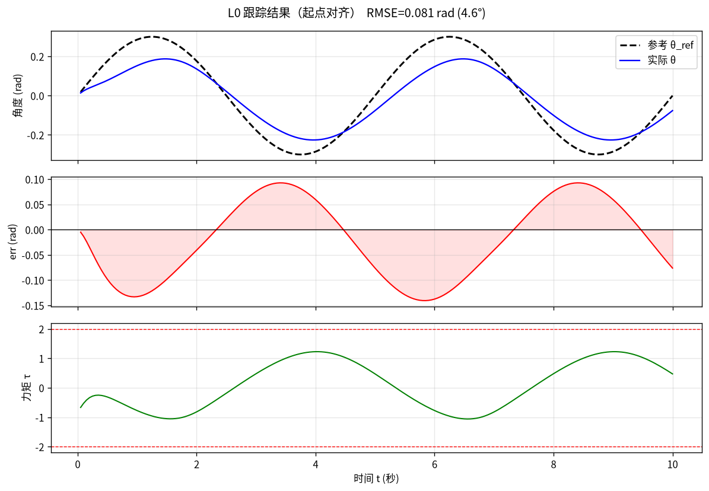

# supermimic-ladder

复现 **SuperMimic**（arXiv:2610.28480）的分层验证工程：从玩具环境的最小 sanity check，逐级爬升到完整的三阶段训练循环。

每一步都能独立跑通、独立验证，避免一上手就调大型物理仿真 + 世界模型的联合系统。

## 路线图

| 层级 | 目标 | 仿真 / 算法 | 状态 |
|---|---|---|---|
| **L0** | 最小 motion imitation sanity check | Pendulum-v1 + PPO + 手工参考轨迹 | ✅ 完成 |
| **L1** | PPO baseline 跑通 | [MimicKit](https://github.com/xbpeng/MimicKit) + PPO | ⬜ 待做 |
| **L2** | 替换为 SuperMimic 三阶段循环 | 采集 → 拟合世界模型 f_ω → BPTT 更新 π_θ | ⬜ 待做 |

## L0 结果

400k 步 PPO（课程式振幅，CPU 约 3 分钟），参考轨迹 `θ_ref(t) = 0.3·sin(2π·0.2·t)`：

| 协议 | 说明 | RMSE | MAE | 最大误差 |
|---|---|---|---|---|
| **A 起点对齐** | 杆子放在参考轨迹起点，衡量纯跟踪精度 | **0.0805 rad（4.61°）** | 0.0704 rad | 0.1406 rad |
| **B 随机初始态** | Gymnasium 随机初始角，含刹车归位 | 0.7377 ± 0.1765 rad（42.3°） | — | — |



上：角度跟踪（黑虚线参考 / 蓝实线实际）；中：逐步跟踪误差；下：力矩。

两点观察：

- 实际振幅只有 0.19~0.20，参考是 0.30，**欠摆约 35%** 并带轻微相位滞后。这是 PPO 学出「保守控制器」的典型表现——误差是平方惩罚，过冲的风险累积更大，于是宁可少动。
- 协议 B 明显劣于 A：**跟踪会了，恢复没会**。随机初始姿态下它得先满力矩刹车，头一秒基本在救火。这是真机部署时的常见短板。

## 环境准备

```bash
python3 -m venv .venv
source .venv/bin/activate

# PyTorch：CPU 版够用（MLP 策略在 GPU 上是负优化）
pip install torch --index-url https://mirror.sjtu.edu.cn/pytorch-wheels/cpu

pip install -r requirements.txt
```

验证：

```bash
python -c "import torch, stable_baselines3, gymnasium; print(torch.__version__, stable_baselines3.__version__, gymnasium.__version__)"
```

## 运行

```bash
cd supermimic_l0

python train_curriculum.py    # 训练，产出 models/l0_ppo_curriculum.zip
python eval_tracking.py       # 评估，产出 assets/l0_tracking_final.png
```

`models/l0_ppo_curriculum.zip` 已随仓库分发，只想复现指标的话跳过训练，直接跑 `eval_tracking.py` 即可。

## 目录结构

```
.
├── README.md
├── requirements.txt
├── .gitignore
└── supermimic_l0/
    ├── tracking_env.py         # 跟踪环境：相位进观测 + 可调振幅 + 力矩可行性检查
    ├── train_curriculum.py     # 课程式振幅训练
    ├── eval_tracking.py        # 双协议评估 + 出图
    ├── assets/
    │   └── l0_tracking_final.png
    └── models/
        └── l0_ppo_curriculum.zip
```

## L0 踩过的三个坑

这一节比结果更有价值——三个坑单独看都像是「训练没学好」，实际都不是。

**坑 1：参考相位不在观测里**

最初观测沿用原生 Pendulum 的 `[cosθ, sinθ, θ̇]`。但目标角度由时间决定：`t=1.25s` 目标是 +0.6，`t=3.75s` 目标是 −0.6，而这两个时刻的观测可以完全一样。策略面对的是部分可观测问题，同一输入对应两个相反答案，梯度只能取平均，最后收敛到「匀速转圈」——因为转圈不区分相位。

修法：观测追加 `[θ_ref, θ̇_ref]`，共 5 维。这也是 motion imitation 的标准做法：参考动作的相位是策略的输入，不是隐藏变量。

**坑 2：参考轨迹在力矩上不可行**

Pendulum-v1 的动力学是 `θ̈ = 15·sinθ + 3u`（**无阻尼**，阻尼只出现在原生 reward 里）。想让杆子静止在某角度需要 `u = 5·sinθ`，而 `|u| ≤ 2`，所以最大可静止角约 `0.41 rad`。

而最初的参考振幅取了 `1.0`，精确跟踪需要峰值力矩 3.14，比上限高 57%。策略是在**追一个物理上够不着的靶子**——力矩全程顶在 ±2，杆子被顶得越转越快。降低到 0.3 后所需峰值力矩 1.64，落回可行域。

`tracking_env.required_peak_torque()` 可以在训练前一行代码验证这一点。

**坑 3：躺平是更强的局部最优**

振幅降到 0.3 后策略不转圈了，改成把杆子按在 θ=0 一动不动。因为躺平的每步代价只有 `A²/2 = 0.045`，已经相当划算；而从躺平变成跟踪，中间必须经历一段「先动起来、误差反而变大」的过程，梯度只认眼前收益，于是出不来。

修法：课程学习——振幅从 0.05 线性涨到 0.3（前 250k 步）。策略始终待在「跟踪」这个盆地里，不会掉回躺平。

## 两个基础设计

**角度误差必须 wrap-around**

`θ = π` 和 `θ = −π` 是同一个位置，直接相减会得到 `2π` 的虚假误差。所有角度差都用 `atan2(sin(Δ), cos(Δ))` 包到 `[−π, π]`。

**tracking reward 完全覆盖原生 reward**

Pendulum-v1 原生奖励鼓励摆杆「停在上方静止」，与「持续摆动跟踪参考轨迹」直接冲突。因此 wrapper 丢弃原生 reward，只用：

```
r = −(err² + 0.001·‖a‖²)
```

早先尝试「原生 reward + tracking 惩罚叠加」时，agent 会学会停在平衡点不动。

## 引用

```bibtex
@article{supermimic2026,
  title   = {SuperMimic},
  journal = {arXiv preprint arXiv:2610.28480},
  year    = {2026}
}
```
