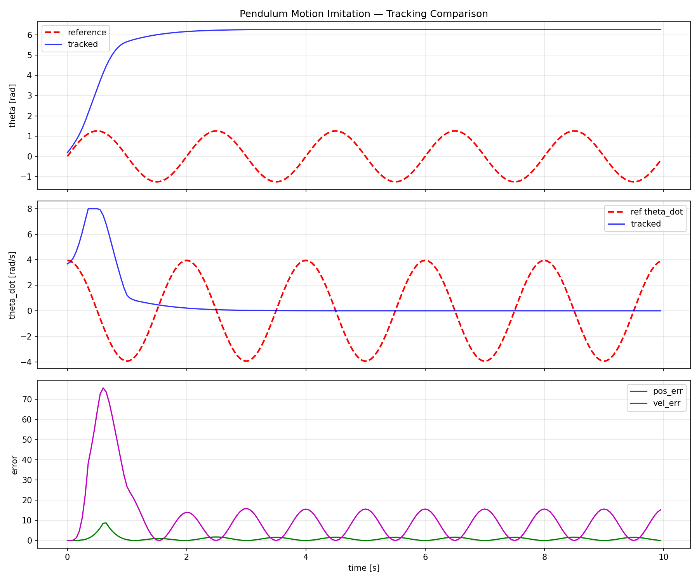

# supermimic-ladder

复现 **SuperMimic**（arXiv:2610.28480）的分层验证工程：从玩具环境的最小 sanity check，逐级爬升到完整的三阶段训练循环。

每一步都能独立跑通、独立验证，避免一上手就调大型物理仿真 + 世界模型的联合系统。

## 路线图

| 层级 | 目标 | 仿真 / 算法 | 状态 |
|---|---|---|---|
| **L0** | 最小 motion imitation sanity check | Pendulum-v1 + PPO + 手工参考轨迹 | ✅ 完成 |
| **L1** | PPO baseline 跑通 | [MimicKit](https://github.com/xbpeng/MimicKit) + PPO | ⬜ 待做 |
| **L2** | 替换为 SuperMimic 三阶段循环 | 采集 → 拟合世界模型 f_ω → BPTT 更新 π_θ | ⬜ 待做 |

## L0 结果

300k 步 PPO 训练，CPU 约 2 分钟（~1600 fps）。

| 指标 | 数值 |
|---|---|
| explained_variance | 0.998 |
| episode reward（tracking） | −432 |
| position RMSE | **0.97 rad**（≈56°） |
| velocity RMSE | 3.32 rad/s |



上：角度跟踪（红虚线参考 / 蓝实线实际）；中：角速度；下：逐步跟踪误差。

## 环境准备

```bash
python3 -m venv .venv
source .venv/bin/activate

# PyTorch：CPU 版走镜像，比官方源快
pip install torch --index-url https://mirror.sjtu.edu.cn/pytorch-wheels/cpu

# 其余依赖
pip install -r requirements.txt
```

验证：

```bash
python -c "import torch, stable_baselines3, gymnasium; print(torch.__version__, stable_baselines3.__version__, gymnasium.__version__)"
```

## 运行

```bash
cd supermimic_l0

# 训练
python train.py --total-timesteps 300000 --pattern sine --output-dir output_final

# 评估（加载已保存模型，输出跟踪对比图与定量指标）
python train.py --eval --output-dir output_final
```

参考轨迹支持三种模式：`sine`（正弦摆动）、`swingup`（摆起并保持）、`random_walk`（平滑随机游走）。

## 目录结构

```
.
├── README.md
├── requirements.txt
├── .gitignore
└── supermimic_l0/
    ├── train.py                 # 参考轨迹生成 + 跟踪奖励 wrapper + PPO 训练/评估
    ├── test_wrapper.py          # 不依赖 torch 的 wrapper 单测
    ├── assets/
    │   └── l0_tracking_comparison.png
    └── output_final/            # 训练产物（被 .gitignore 忽略）
```

## L0 的两个关键设计决策

**1. 角度误差必须 wrap-around**

Pendulum 的 `theta = π` 和 `theta = −π` 是同一个位置，直接相减会得到 `2π` 的虚假误差。所有角度差都用 `atan2(sin(Δ), cos(Δ))` 包到 `[−π, π]`。

**2. tracking reward 完全覆盖原始 Pendulum reward**

Pendulum-v1 原生奖励鼓励摆杆「停在上方静止」，与「持续摆动跟踪参考轨迹」的目标直接冲突。因此 wrapper 丢弃原生 reward，只用：

```
r = −(‖Δθ‖² + w_v·‖Δθ̇‖² + 0.001·a²)
```

早先尝试「原生 reward + tracking 惩罚叠加」的方式，agent 会学会停在平衡点不动，跟踪 RMSE 反而更差。

## 引用

```bibtex
@article{supermimic2026,
  title   = {SuperMimic},
  journal = {arXiv preprint arXiv:2610.28480},
  year    = {2026}
}
```
